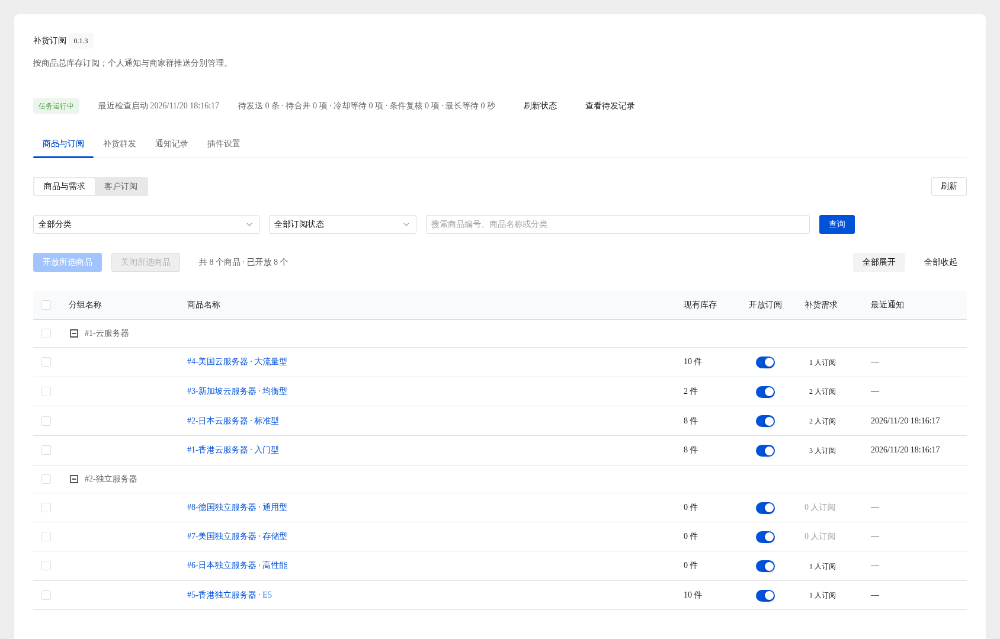
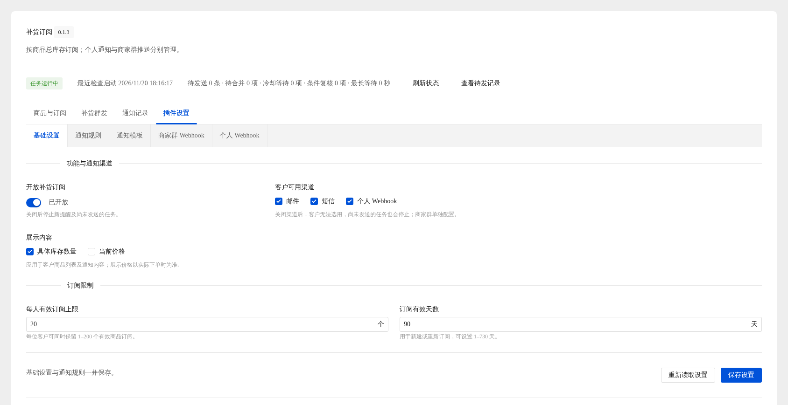
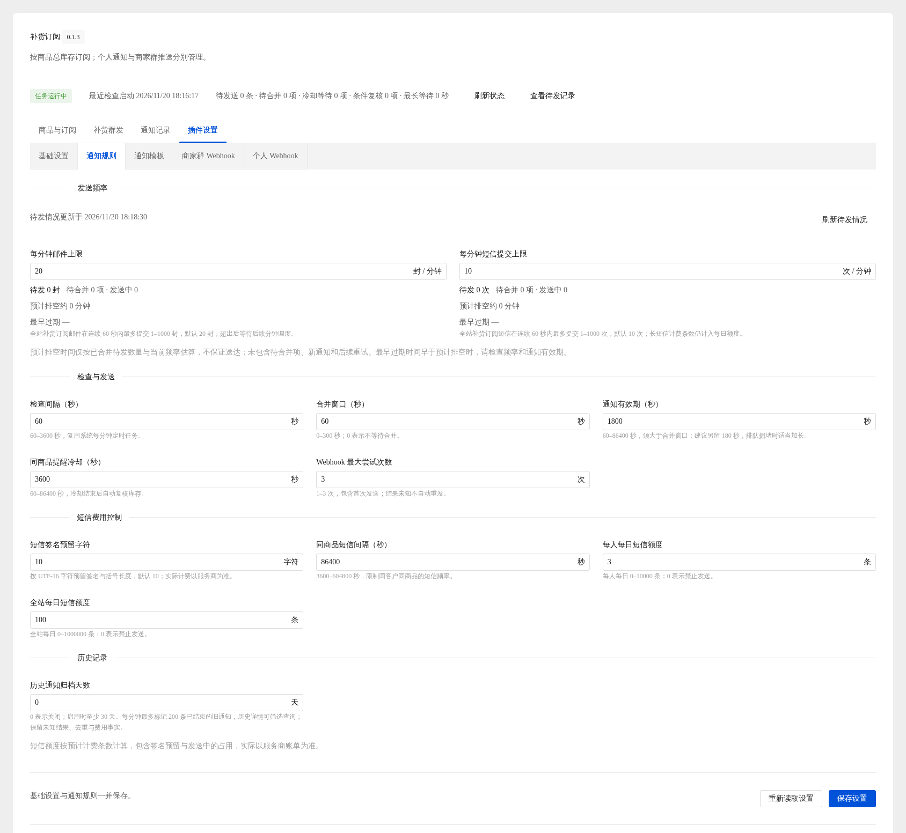
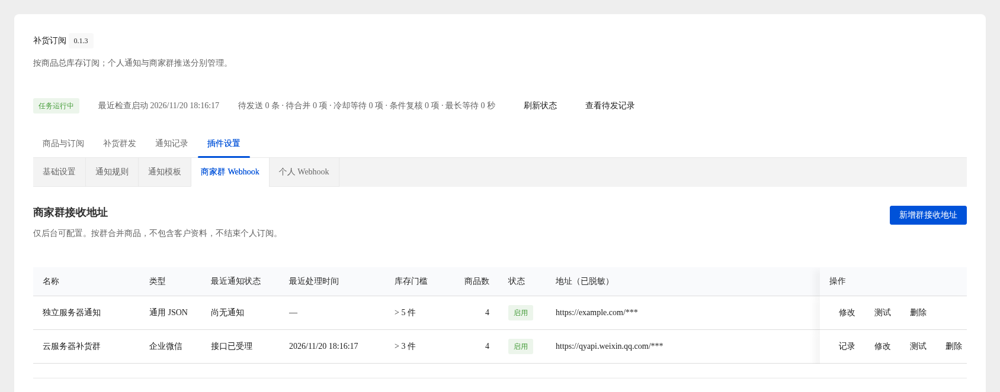
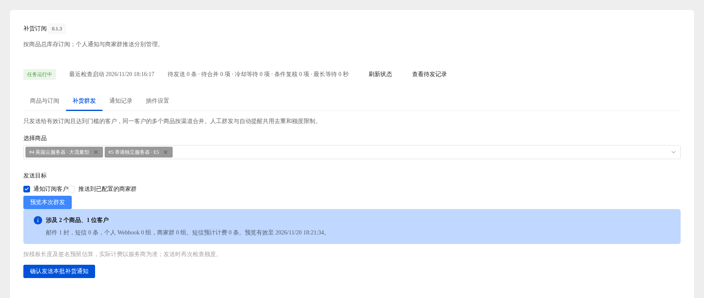
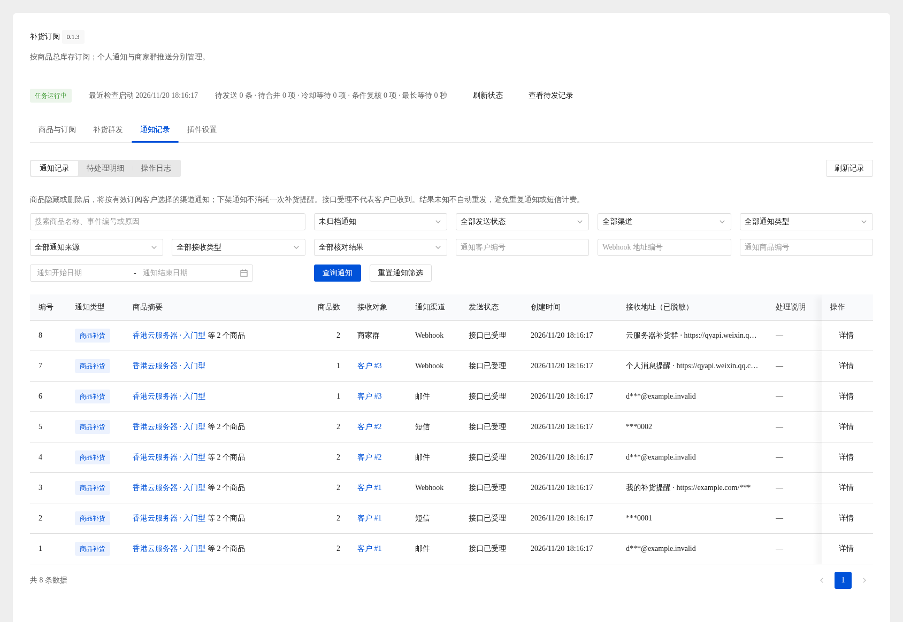
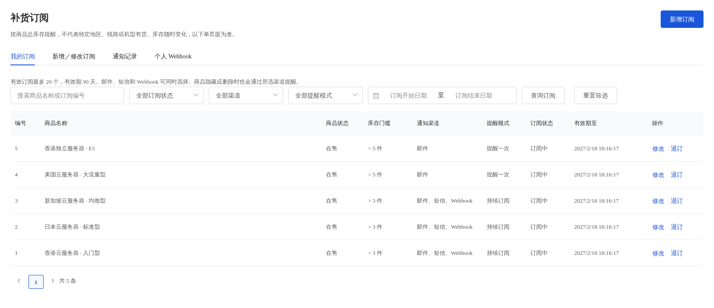
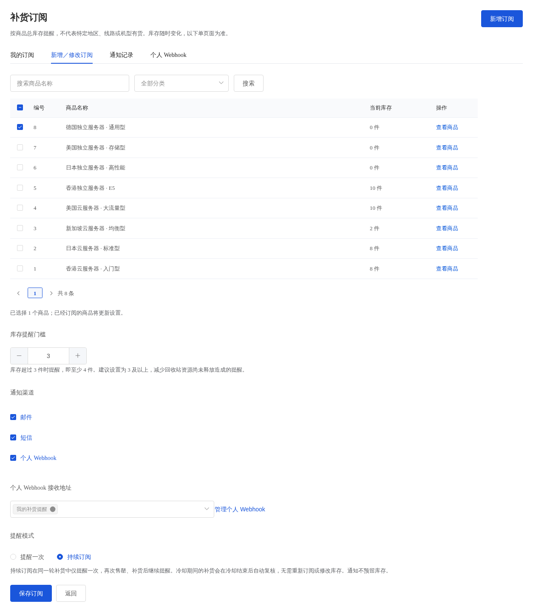
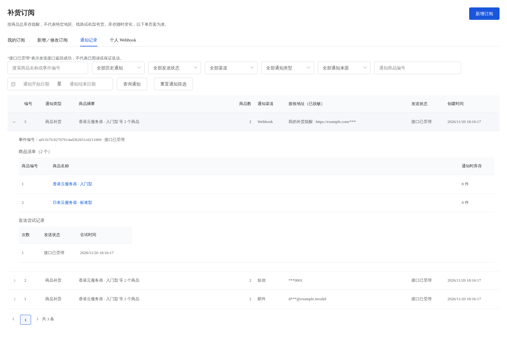
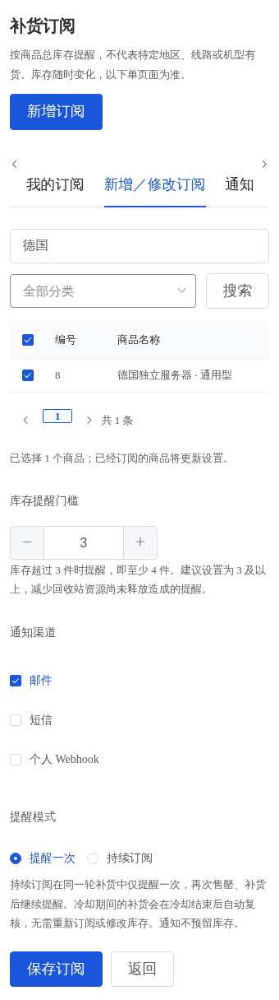

# 界面预览

[返回项目首页](../README.md) · [配置指南](guide.md)

截图版本：**补货订阅 0.1.3 测试版**，智简魔方 V10 业务系统 10.7.4，截图日期：2026-11-20。以下为插件实际界面，已裁去系统导航；页面样式和布局会随主题、窗口宽度及配置变化。

商品、账户、联系方式和接收地址均为演示数据。通知记录由模拟接收端生成，仅展示多商品合并与结果追踪界面，不表示向真实客户发送或保证最终送达。示例中短信已开启，插件默认关闭短信。

## 后台管理

### 商品与需求

沿用系统商品分类，支持分类选择、批量开放订阅及搜索筛选，同时展示库存、订阅需求和最近通知。

### 基础设置

统一控制功能开关、客户可用渠道、库存和价格展示，以及每人订阅数量与有效期。

### 通知规则与发送频率

邮件、短信分别设置每分钟提交上限；查看待发情况和预计排空时间，并调整检查间隔、合并窗口、通知有效期、短信额度及历史归档。

### 商家群 Webhook

群地址仅由后台配置，可设置商品范围和库存门槛，独立查看最近通知结果；支持企业微信、钉钉与通用 JSON。

### 补货群发预览

多选商品后先预览去重客户数、渠道数量和短信预计计费条数，再确认发送；客户通知与商家群推送分别选择。

### 通知记录

按客户、商品、渠道、类型、状态与时间筛选，查看合并后的商品摘要、脱敏接收地址和处理结果；后台另有待处理明细与操作日志。

## 会员中心

### 我的订阅

集中管理库存门槛、通知渠道、一次提醒或持续订阅，支持搜索筛选、修改与退订。

### 新增与修改订阅

按分类搜索并多选商品，批量设置门槛和渠道；个人 Webhook 可以复用已保存的接收地址。门槛为 3 时，库存至少达到 4 件才会提醒。

### 通知详情

会员仅查看本人通知，展开后可查看本次完整商品清单、通知时库存及发送尝试，不展示后台未通知原因。

### 手机端订阅

小屏幕下表单纵向排列，保留商品搜索、库存门槛、渠道及提醒模式；较宽的表格可以在表格内部横向滚动。

